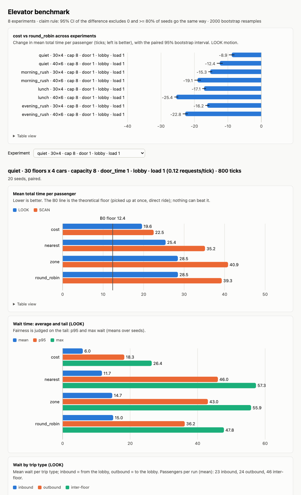
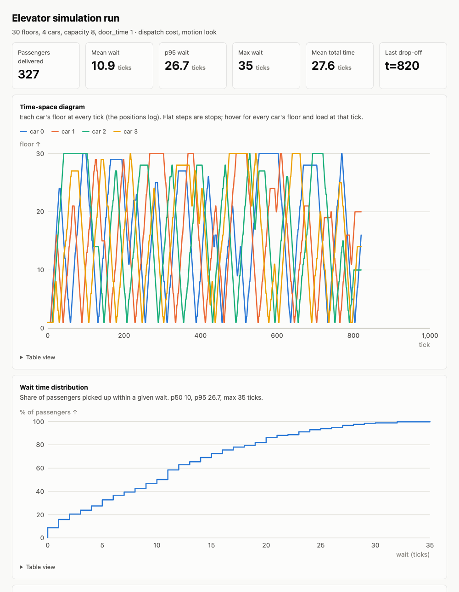

# Elevator System Simulation

A discrete-time simulation of a destination-dispatch elevator system: passengers give their origin and destination
when they make a request, the controller assigns them to one car straight away, and the simulation moves time forward
one tick (one floor of travel) at a time.

It reads requests in the brief's format (`time,id,source,dest`), never looks ahead of the current
tick, and writes the brief's two outputs: a **positions log** (every car's floor at every tick from
t = 0) and **passenger statistics** (min / max / average wait and total time, plus observations).
On top of that it compares four dispatch policies and two motion rules on realistic office-building
traffic, explains *why* one policy beats another, and renders the results as an HTML report.

**Contents:** [The brief, and where it's met](#the-brief-and-where-its-met) ·
[Quick start](#quick-start) · [Findings at a glance](#findings-at-a-glance) ·
[How it works](#how-it-works-who-decides-what) · [Code layout](#code-layout) ·
[Detailed studies](#detailed-studies) · [Visual report](#visual-report) ·
[Reproduce every result](#reproduce-every-result) · [Testing](#testing) ·
[Assumptions and trade-offs](#assumptions-and-trade-offs) ·
[What I'd improve](#what-id-improve-with-more-time) · [How I used AI](#how-i-used-ai) ·
[Time spent](#time-spent) · [Development](#development)

## The brief, and where it's met

| The brief asks for | Where it's met |
|---|---|
| Discrete time, one tick = one floor, ticking one unit at a time even through gaps | `Simulator.step()`; positions log has one row per tick from t = 0 (`test_positions_log_has_one_row_per_tick_from_zero_including_idle_gaps`) |
| Don't peek ahead in the request list | lazy, validated feed; requests released only at their tick (`test_policies_never_see_a_request_before_its_time`) |
| Configurable elevators, floors, capacity | `--elevators`, `--floors`, `--capacity` (and `run_requests(...)`); swept in the [building sweep](docs/buildings.md) |
| Destination dispatch: origin + destination given, car assigned immediately | every request is assigned on its tick, before cars move ([how it works](#how-it-works-who-decides-what)) |
| A function that accepts a list of requests | `run_requests(...)` ([Quick start](#quick-start)); the CLI reads the brief's CSV |
| Honour capacity and direction | the car refuses to board over capacity; only passengers heading the car's way board ([capacity](#assumptions-and-trade-offs)) |
| Serve all requests eventually | 0 unserved in 15,360 runs (4.0 million passengers); worst single-run wait under `cost` 73 ticks in the standard suite ([evidence](docs/results.md#serving-everyone-the-evidence)) |
| Minimise total time per passenger | `cost` dispatch: 31-47% lower than round-robin ([results](docs/results.md)) |
| Output 1: positions log | `positions.jsonl` and `positions.csv` |
| Output 2: min / max / average wait and total time, plus observations | `report.json` and the printed summary |
| Bonus: different algorithms | ✓ round-robin, nearest, zone, cost; LOOK and SCAN ([results](docs/results.md)) |
| Bonus: fairness vs efficiency | ✓ fairness weight on `cost` ([fairness](docs/fairness.md)) |
| Bonus: express elevators | ✗ not built: cars that serve only some floors work and are tested, transfers don't; measurement was prioritised over this feature ([scope decisions](#scope-decisions-for-the-remaining-plan-items)) |
| README: how to run, time spent, assumptions, improvements | [Quick start](#quick-start), [Time spent](#time-spent), [Assumptions](#assumptions-and-trade-offs), [What I'd improve](#what-id-improve-with-more-time) |

## Quick start

```bash
./scripts/install.sh        # installs uv if missing, then `uv sync` (creates .venv from uv.lock)
uv run elevator-sim examples/brief.csv --elevators 3 --floors 60 --capacity 8

uv run elevator-sim generate morning_rush --floors 30 --duration 800 -o rush.csv
uv run elevator-sim rush.csv -f 30 -e 4 --algorithm cost --journal out/run.jsonl
uv run elevator-sim summarize out/run.jsonl   # rebuilds the report without re-simulating
uv run elevator-sim rush.csv -f 30 -e 4 --html  # also writes out/report.html (open it)
uv run elevator-sim report results/standard -o out/bench.html   # benchmark report
uv run elevator-sim run --help                # all options
```

A step-by-step [demo walkthrough](docs/demo.md), with expected outputs and setup for a machine without uv.

`elevator-sim` is the console script declared in `pyproject.toml` (`python -m elevator_sim` is
equivalent). Input is a CSV in the brief's format, `time,id,source,dest`.

The same as a function, for the brief's "function that accepts a list of requests":

```python
from elevator_sim import run_requests

result = run_requests(
    [(0, "passenger1", 1, 51), (0, "passenger2", 1, 37), (10, "passenger3", 20, 1)],
    elevators=3,
    floors=60,
    capacity=8,
)
result.positions[0]  # every car's floor at t = 0: [1, 1, 1]
result.report.wait.max, result.report.total.mean  # the passenger statistics
```

### Outputs (in `--out`, default `out/`)

| File | Contents |
|---|---|
| `positions.jsonl` | The positions log: one JSON object per tick from t = 0, e.g. `{"t":0,"floors":[1,1,1]}` (`floors[i]` is car i's floor) |
| `positions.csv` | The same log as a table, `t,car_0,car_1,...` (opens in a spreadsheet) |
| `passengers.json` | One record per passenger: car, requested / boarded / alighted ticks, wait, travel, total |
| `report.json` | The run's metrics (below) |

`report.json` holds the passenger time distributions, completed travels, per-car stats, root-cause
diagnostics and plain-language observations. Every field, and why it is measured, is listed under
[Metrics](docs/metrics.md#metrics-what-we-measure-and-why). The same numbers are printed as a text summary at the end of each run.

## Findings at a glance

All numbers are means over 20 paired seeds; "better" means the 95% CI of the difference excludes 0
and at least 80% of seeds agree. Details and tables are in the sections linked.

- **`cost` dispatch is the best policy**: 31-47% lower mean total time per passenger than
  round-robin in all 8 standard experiments (better in 20 of 20 seeds every time), closing 52-73%
  of the gap to the theoretical floor. It stays best in all 48 door-time / start-position
  settings. [Results](docs/results.md#results-cost-vs-round_robin-look-motion-mean-total-time-per-passenger-in-ticks)
- **Why round-robin loses**: it ignores where cars are going, so in busy periods 46-50% of its
  passengers get a car that is moving away from them; the empty travel keeps its cars 95-98% busy,
  at saturation. All of the difference is waiting time, not ride time.
  [Root cause](docs/results.md#why-cost-wins-root-cause-look-motion-from-the-diagnostics-columns-in-summarymd)
- **`nearest` backfires in the rushes**: it piles passengers onto the car near the lobby, so 6-12%
  of them watch their own car pass full; it is significantly worse than round-robin in the morning
  rush and gets worse as stops get longer. [Sensitivity](docs/sensitivity.md#sensitivity-stop-time-and-start-position)
- **`zone` is a strong simple policy for rush hours** (19-20% better than round-robin), and in an
  overloaded morning rush (45-60 floors on 4 cars) it even beats `cost`: banding cars by destination
  shortens their round trips. [Building sweep](docs/buildings.md#building-sweep-floors-cars-and-capacity)
- **LOOK beats SCAN** almost everywhere (up to 29% with `cost` in the evening rush).
- **The building matters more than the algorithm at the extremes**: 4 cars can't serve a 45- or
  60-floor office at rush hour, more cars help with diminishing returns past 6, and capacity only
  matters when it is tight (at capacity 4, `cost`'s capacity-aware projection cuts full-car
  pass-bys to 7-21% vs 20-39% for round-robin).
- **Parking idle cars helps when it matches the traffic**: back to the lobby before the morning
  rush (up to 17% better), spread out when it's quiet (5.5%); a demand-following policy is never
  worse and needs no knowledge of the scenario, at the price of extra travel.
  [Parking](docs/parking.md#parking-idle-cars)
- **Fairness costs nothing measurable**: a fairness weight on `cost` trims the worst rush-hour waits
  by 7-10 ticks under heavy load with no significant change in mean total time; there is no
  per-passenger guarantee. [Fairness](docs/fairness.md#fairness-vs-efficiency)

## How it works: who decides what

Two separate decisions, made by different parts of the code at different times:

| | Dispatch policy: *which car?* | Motion policy: *how does a car move?* |
|---|---|---|
| Asked by | the `Dispatcher` | each `Car`, about itself |
| When | once per passenger, on the tick they ask | every tick, for every car |
| Sees | every car (read-only views) | its own car: floor, direction, load, its own passengers |
| Options | `round_robin`, `nearest`, `zone`, `cost` (default) | `look` (default), `scan` |
| Answer | a car id; the assignment is final | move up / down, open doors, or idle; and who boards |

Each tick: new requests are assigned (dispatch), then every car acts (motion), then positions are
logged and moving cars advance one floor. The `Car` enforces the rules (capacity, door timing)
whatever a policy says, and the `Dispatcher` is the only code that changes a car.

- **`round_robin`**: cars in turn; looks at nothing. **`nearest`**: the car closest to the
  passenger's floor, whatever it is doing. **`zone`**: each car owns a band of floors; a trip goes
  to the owner of its upper floor.
- **`cost`**: for each car, simulate its future with and without the new passenger (`project()`
  runs the car's own motion rules, capacity check and door timing on a copy) and pick the car where
  the total time of everyone assigned to it grows least: the newcomer's wait and ride plus any
  delay to passengers already assigned. Ties go to the lowest id. An optional fairness weight
  (`--fairness`, `cost:<α>` in the benchmark) adds α × the increase in the sum of squared waits;
  see [Fairness vs efficiency](docs/fairness.md#fairness-vs-efficiency).
- **LOOK**: keep going while any of this car's passengers need a floor ahead; reverse when nothing
  lies ahead; idle when there is no work. **SCAN**: the same, but always run to the end of the
  shaft before reversing.

## Code layout

```
elevator_sim/
  model.py        value types: Request, CarSpec, BuildingConfig (floors, cars, door_time)
  feed.py         request feed (lazy, validated, never ahead of the clock) and the Clock
  motion.py       motion policies: LOOK, SCAN (where a car goes, when it stops, who boards)
  car.py          the Car state machine (doors, capacity) and project(), the only look-ahead
  dispatch.py     dispatch policies: cost (+ fairness), nearest, zone, round_robin
  parking.py      parking policies: stay, lobby, spread, demand (where idle cars wait)
  dispatcher.py   per tick: assign new requests, step every car; the only code that changes cars
  simulator.py    Simulator (one tick at a time) and simulate() (a whole run)
  events.py       the event types; journal.py: the append-only journal (save / load as JSONL)
  report.py       aggregate(): journal -> RunReport (stats, per car, by trip type, diagnostics)
  adapters.py     files at the edge: CSV in; positions / passengers / report JSON out; summary
  scenarios.py    business-building traffic: three Poisson streams, generated once per seed
  bench.py        the evaluation harness: paired runs, baselines, bootstrap CIs, suites
  html_report.py  the self-contained HTML report
  api.py          run_requests(): the brief's function, a list of requests in, positions and stats out
  __main__.py     the CLI: run, summarize, generate, bench, report
scripts/          install.sh (uv setup); readme_tables.py (the README's tables from results/)
tests/            253 tests (unit, scenario, golden, invariant, property-based, benchmark, report, CLI)
results/          committed benchmark summaries (standard, sensitivity, fairness, buildings, parking)
```

Information flows one way: feed → clock → dispatcher → cars → journal → report. Policies get
read-only views and return an answer; they can't move a car or see the future. Every output is
computed from the journal, so a saved run can be re-analysed without simulating again.

## Detailed studies

Each study is regenerated by one command ([Reproduce every result](#reproduce-every-result)) and every table in
these pages is generated from `results/` by `scripts/readme_tables.py`.

| Page | What it covers |
|---|---|
| [Metrics](docs/metrics.md) | every metric in the reports and the benchmark, with its definition and why it's measured |
| [Traffic scenarios](docs/scenarios.md) | the business-building model: three Poisson streams, four scenarios, generated once per seed |
| [Results](docs/results.md) | how results are measured (paired seeds, baselines, bootstrap CIs, claim rule); `cost` vs round-robin; the root cause; capacity and trip types |
| [Sensitivity](docs/sensitivity.md) | door time 0 / 1 / 2 and start position: which conclusions survive |
| [Building sweep](docs/buildings.md) | floors, cars and capacity one at a time; where `zone` beats `cost` |
| [Parking](docs/parking.md) | where idle cars should wait; the three decisions and what the data said |
| [Fairness](docs/fairness.md) | the fairness weight on `cost` and its frontier |
| [Performance](docs/performance.md) | how projections were made 5× faster with identical results |
| [Demo walkthrough](docs/demo.md) | a five-minute tour on a fresh machine, with expected outputs |
| [Presentation outline](docs/presentation.md) | the 10-minute talk and demo |

## Visual report

The benchmark reports are committed: `results/<study>/report.html` (standard, sensitivity,
fairness, buildings, parking). Download one from GitHub and open it in a browser; no Python needed.

`elevator-sim report` turns a run journal or a benchmark folder into **one self-contained HTML
file** (inline SVG and a little JavaScript, no dependencies, works offline: open it by
double-click). `run --html` writes one next to the run's other outputs.

```bash
uv run elevator-sim rush.csv -f 30 -e 4 --html -o out/rush          # out/rush/report.html
uv run elevator-sim report out/run.jsonl -o out/run.html            # from a saved journal
uv run elevator-sim report results/standard -o out/bench.html       # from a benchmark folder
uv run elevator-sim report results/fairness -o out/fairness.html    # includes the frontier
uv run elevator-sim report results/buildings -o out/buildings.html  # trend per floors / cars / capacity
```

| Report | Views |
|---|---|
| Run | headline tiles (passengers, mean / p95 / max wait, mean total, last drop-off); the **time-space diagram** (every car's floor at every tick, with a crosshair that reads each car's floor and load); the wait distribution; wait by trip type (inbound / outbound / inter-floor); the state of the assigned car (idle / on the way / ahead but heading the other way / moving away); passengers per car; observations; the passenger table |
| Benchmark | `cost` vs `round_robin` across all experiments with 95% CIs; for a building sweep, a trend line per setting (floors, cars, capacity) and scenario; then, for the experiment picked in the selector: mean total by policy and motion against the B0 floor, the wait tail (mean, p95, max), wait by trip type, the root-cause diagnostics (assigned to a car moving away, how busy the cars were), and the fairness frontier when the run swept α |

Every chart has a table view, hover and keyboard focus show exact values, colours come from a
palette validated for colour-vision deficiency in light and dark mode, and all text from the data
is escaped.





## Reproduce every result

```bash
./scripts/install.sh                                     # once: uv + the locked environment
uv run elevator-sim bench --suite standard --seeds 20 -o results/standard
uv run elevator-sim bench --suite standard --seeds 20 --door-times 0,1,2 --placements lobby,spread \
    -o results/sensitivity
uv run elevator-sim bench --suite standard --seeds 20 --loads 1,1.5 --dispatch round_robin \
    --fairness 0,0.05,0.2,1 --motion look -o results/fairness
uv run elevator-sim bench --suite buildings --seeds 20 -o results/buildings
uv run elevator-sim bench --suite standard --seeds 20 --parking stay,lobby,spread,demand \
    --dispatch cost,round_robin --motion look -o results/parking
uv run python scripts/readme_tables.py                  # prints every results table in this README
for r in standard sensitivity fairness buildings parking; do
    uv run elevator-sim report results/$r -o results/$r/report.html
done
```

About 16 minutes on 10 cores in total. Runs are deterministic: the same command gives
byte-identical `raw.jsonl` files (a test checks this, in-process and across worker processes).
`summary.json`, `summary.md` and the HTML `report.html` are committed for all five studies (a
test checks each committed report is exactly what its summary renders to); `raw.jsonl` only for the
standard suite (the others are large and regenerated by the commands above).

## Testing

253 tests (`uv run pytest --cov`, about 10 s; coverage 99%, gate 95%; CI on Python 3.10-3.13).
Expected values in the hand-worked tests were computed by hand first, tick by tick, and the tests
written to match; the comments show the working.

| Kind | What it pins down | Tests to look at |
|---|---|---|
| **Function entry point** | `run_requests()` reproduces the golden brief timeline from plain `(time, id, source, dest)` rows, accepts options, validates like the CLI; `positions.csv` has one row per tick | `test_api.py` |
| **Golden** | The brief's three-row example, exact boarding and drop-off ticks, with door_time 0 and 1, and with 3 cars | `test_simulate.py::test_brief_example_one_car_door_time_0` (and `_1`, `_three_cars`) |
| **Rules** | One floor per tick; a stop holds the car `door_time + 1` ticks; a request made while the doors are open still boards; assignment happens before cars move, so asking where your car stands means wait 0; no request is visible before its tick | `test_car.py::test_stop_timeline_with_door_time_1`, `test_car.py::test_request_made_mid_dwell_still_boards`, `test_dispatch.py::test_policies_never_see_a_request_before_its_time` |
| **Capacity along the route** | A full car frees room at floor 6 and uses it at floor 8 on the same sweep; three waiting with room for two (the third is picked up at t15); `project()` predicts both before they happen; `cost` picks the full car only when it frees room in time | `test_capacity_scenarios.py` (8 tests) |
| **Policies** | Round-robin cycles and ignores car state (wait 33 vs 1 under `cost` on the same input); `nearest`, `zone` and `cost` choose as specified; ties go to the lowest id; a policy can't choose a car that can't serve the trip | `test_capacity_scenarios.py::test_round_robin_ignores_car_state`, `test_dispatch.py` |
| **Motion** | LOOK keeps going while work lies ahead and reverses when none does; SCAN runs to the end; and a counterexample: LOOK *can* travel further than SCAN when requests arrive over time | `test_motion.py::test_look_can_travel_further_than_scan_when_requests_arrive_over_time` |
| **Invariants** | Over every dispatch × motion × door_time combination (24 runs, all four scenarios): one positions row per car per tick from t = 0, never over capacity, never more than one floor per tick, never moving with doors open, every passenger seen on their tick, assigned once, carried by that car from their floor to their destination | `test_invariants.py` with `helpers.check_invariants` |
| **Property-based** (hypothesis) | On random buildings (2-30 floors, 1-5 cars, capacity 1-10, door_time 0-2, either start placement), random traffic and random policies (every dispatch incl. a fairness weight, both motions, every parking policy): every run terminates, serves everyone and keeps every invariant; the fast projection equals the exact step-by-step one at every tick, with and without an extra passenger; a projection predicts every real pickup and drop-off when no more requests arrive. Checked for teeth: deliberately breaking the floor-skip by one floor makes the property fail at once | `test_properties.py` |
| **Projection** | `project()` predicts the real stops exactly when no new requests arrive, for LOOK and SCAN at door_time 0, 1 and 2 | `test_route.py::test_route_predicts_the_real_stops_when_no_new_requests_arrive` |
| **Determinism and replay** | Same inputs, identical journal; a saved journal rebuilds an identical report; benchmark output byte-identical in-process and across worker processes | `test_simulate.py::test_same_inputs_give_an_identical_journal`, `test_bench.py::test_same_seed_gives_byte_identical_raw_output_in_and_across_processes` |
| **Liveness guards** | A policy that never serves anyone is caught; a long idle gap is not mistaken for a stall | `test_simulate.py::test_a_car_that_stops_serving_after_assignment_trips_the_stall_guard` |
| **Scenarios** | Each Poisson stream has the right rate and variance ≈ mean; the inter-floor passengers are identical in every scenario; the quiet inbound stream is contained in the rush's | `test_scenarios.py::test_arrivals_are_poisson_with_the_scenario_rates`, `::test_streams_are_generated_once_and_shared_by_every_scenario` |
| **Measurement** | Every policy in a seed sees identical requests (fingerprints); B0 equals the mean direct ride; gap closed is 0 at the baseline and 1 at the floor; the verdict needs both significance and consistency | `test_bench.py` |
| **Parking** | An idle car returns to the lobby and a waiting passenger then boards at once (wait 0 vs 5); a parking car turns around as soon as it is assigned; `spread` homes; `demand` picks the busiest recent floor, skips claimed floors and never sees a future request; every invariant holds under every parking policy | `test_parking.py` |
| **Diagnostics, fairness, report** | Assignment-state classification; full-car pass-bys; α = 0 is exactly plain `cost`; fairness shortens the longest wait on a starvation-prone input but not on every input; the HTML report is self-contained and escapes data | `test_diagnostics.py`, `test_fairness.py`, `test_html_report.py` |

## Assumptions and trade-offs

The brief fixes 1 tick = 1 floor, no peeking ahead, and immediate assignment of each passenger to
one car. Everything else below is a choice made here.

**Time**
- Each tick: requests made this tick are assigned first, then every car acts. A passenger who asks
  where their car is already standing boards on the same tick (wait 0).
- Positions row `t` is each car's floor at the start of tick `t`; rows run from t = 0 with no gaps.
- The run ends on the tick of the last drop-off.

**Building**
- Floors are 1..n with no basement; every car serves every floor; cars start at the lobby
  (`--placement` changes that) and an idle car stays where it is (`--parking` changes that; see
  [Parking](docs/parking.md#parking-idle-cars)).
- **Doors: `--door-time 1` by default.** A stop holds the car at the floor for `door_time + 1`
  ticks. The brief doesn't model doors; without a cost for stopping, sharing a car is free and
  every policy looks better than it would in a real building. `--door-time 0` gives the brief's
  pure model; the golden tests cover both.
- Boarding and alighting take no time beyond the stop itself, however many people move.

**Dispatch**
- **Assignments are fixed (our choice).** The brief says a passenger can't change their
  *destination*; it doesn't forbid the controller from moving them to another car. We keep the
  first assignment for the whole journey because real destination-dispatch panels tell the
  passenger which car to wait for, and it keeps every decision explainable. The cost is that an
  early choice can't be undone when better information arrives; re-assignment is listed under
  improvements.
- A car stops only for its own passengers, and only people heading its way board.
- The default policy, `cost`, simulates each car's future with and without the new passenger and
  picks the car where the total time of everyone on it grows least (ties to the lowest id). It
  plans only for requests already made and is greedy: each choice is the best at that moment.

**Capacity: the car decides on arrival, the dispatcher looks ahead**
- Capacity is a hard limit: the car refuses to board anyone over it, whatever the policy says.
  When people are left behind, the first assigned board first.
- **A car decides whether to pick someone up when it arrives at their floor, from its actual
  load**, counting the people getting off at that floor first. It never relies on a prediction.
  So a car that is full when a passenger is assigned still picks them up if enough people get off
  before their floor (full at floor 1, two get off at 6, two board at 8); a car that arrives full
  drives past and comes back.
- *Why:* that is how a real car with a load sensor behaves. If the car is fuller than expected
  (say someone stayed on past their floor), it passes rather than overfilling, and it never opens
  its doors when nobody can get on or off. In the simulation passengers always get off at their
  floor, so this is a design choice for robustness rather than something the model exercises.
- **Looking ahead is the dispatcher's job.** When it assigns a passenger, `cost` runs each car's
  own rules forward (`project()`, with the same capacity check), so a car that would arrive full
  shows up as a late pickup and costs more; `cost` rarely gives someone a car that will pass them.
  `round_robin`, `nearest` and `zone` don't check.
- *Limits:* the projection assumes no new requests. If later assignments fill the car before it
  reaches you, it passes you full and, because assignments are fixed, you wait for it to return.
  The passed passenger pays for this (13 ticks instead of 5 in the test below);
  re-assigning waiting passengers would fix it.
- *Alternative not taken:* a hard filter that rejects any car whose projected load ever exceeds
  capacity is simpler, but turns a car down even when it frees up in time.
- Tests: `tests/test_capacity_scenarios.py` (room freed at 6 used at 8; three waiting with room
  for two; the projection predicting both before they happen; `cost` choosing the full car only
  when it frees room in time).

**Motion**
- LOOK by default: keep going while there is work ahead, reverse when there is none. SCAN (run to
  the end of the shaft before reversing) is available for comparison.

**Input**
- Requests must be in time order, on floors 1..n, with source ≠ dest and unique ids; anything else
  is reported as an error rather than guessed at.

**Metrics**
- Definitions are in [Metrics](docs/metrics.md#metrics-what-we-measure-and-why). Choices made there: travel
  includes stops on the way; percentiles use linear interpolation (numpy's default); a *travel* is
  one passenger's journey; a car *trip* runs from when the car starts to move until it reverses
  or goes idle, and an empty move to fetch someone counts.

**Serving everyone (the brief's first objective).** Every passenger has been delivered in every
run: **4,011,243 passengers in 15,360 runs across the five studies, 0 unserved**, and a property
test checks that random buildings, traffic and policies always finish. In the standard suite the
worst wait in any single run is 73 ticks under `cost` (round-robin 123, `zone` 254, `nearest` 841);
only overloaded buildings, where demand exceeds what the cars can carry, see waits past a thousand
ticks, under every policy. There is no per-passenger guarantee and no max-wait guard, by choice:
the guard's wait limit would have to be tuned on simulated scenarios with illustrative rates, which
risks overfitting to that hypothetical input; it should be calibrated on collected traffic data with
a sample large enough to be significant. Evidence tables and the full reasoning:
[Results: serving everyone](docs/results.md#serving-everyone-the-evidence).

## What I'd improve with more time

- **Re-assign waiting passengers.** Assignments are fixed, so when `cost`'s projection goes stale
  (later passengers fill a car before it reaches you) the passenger pays. Re-assigning while
  someone is still waiting would fix that and also bound the worst waits.
- **A max-wait guard, calibrated on real data.** The fairness weight shortens the tail but
  guarantees nothing per passenger; a guard (re-assign, or serve the oldest request first, past a
  wait limit) would. Its limit should be set from collected request logs, not tuned on these
  simulated scenarios.
- **Sectoring when the up-peak saturates.** In an overloaded morning rush `zone` beats `cost`;
  switching to destination sectoring above a load threshold, or a cost that accounts for round-trip
  time, should get the best of both.
- **Express banks / sky lobbies** (cars that skip floors, with transfers): designed in the plan,
  not built. And a parking policy that switches with the time of day (lobby before the morning
  rush, `demand` otherwise).
- **A full-day timeline** with rates that change through the day, calibrated against real
  building data rather than illustrative rates, and other building types (residential reverses
  the rushes).
- **Boarding time that depends on how many people get on or off**, instead of a fixed stop time.

### Scope decisions for the remaining plan items

- **Express banks / sky lobbies (plan item 3c): kept open.** The car side exists (a car can serve a
  subset of floors and the dispatcher only offers cars that serve both ends of a trip; tested);
  what's missing is splitting a trip at a transfer floor. To be built only if time allows.
- **Demand forecasting and grouping by destination (plan item 3d): not applied.** The traffic here
  is generated from Poisson streams with known rates, so there is nothing for a forecaster to
  learn: it would only rediscover the rates we put in. In a real building the useful step is the
  reverse: accumulate each day's requests, then calibrate the arrival model per time of day (the
  Poisson rates, or a better-fitting distribution if the counts turn out over-dispersed) and feed
  it to parking and dispatch. Grouping passengers with the same destination already happens where
  it pays: `cost` puts lobby passengers into shared stops in the morning rush (1.67 riders per stop
  vs 1.50-1.56 for round-robin).

## How I used AI

I built this with Claude Code (Anthropic's coding agent) as a pair programmer, and drafted the
implementation plan with an AI assistant beforehand. The split:

- **My decisions**: scope and the phase-by-phase order (I reviewed each phase before the next);
  fixed assignments; door_time 1 as the default; JSON outputs and the metrics I wanted reported
  (wait percentiles, travels, car trips); the reasoning for deciding pickups on arrival from the
  car's actual load; the business-building traffic model (three Poisson streams, inter-floor at a
  steady rate, rushes as heavy inbound or outbound, generated once per seed); demand scaling with
  floors in the building sweep; keeping α = 0 as the default; and for parking, keeping `demand`
  to let the results decide, `lobby` as a simple morning-rush rule, and `stay` as the default
  because parking moves cost the building.
- **Delegated**: most of the code and tests, running the benchmarks, drafting the analysis and
  the README text, which I then questioned and edited.
- **How I checked it**: every README table is generated from `results/` by
  `scripts/readme_tables.py`, and every claim in the text was checked against the data; behaviour
  is pinned by hand-worked tests; reports were rendered and looked at, in light and dark mode.

What I'd require of a team working this way: tests and acceptance criteria owned by people;
every reported number generated from data by a script, never typed; every diff reviewed before it
merges; and claims checked against the data, not against what the AI says the data shows.

Where the AI was wrong, and what caught it:
- The plan claimed LOOK never travels further than SCAN. A test found counterexamples when
  requests arrive over time; it only holds when everything is known at t = 0. Both cases are now
  tests.
- The first verdict rule could only say "better", never "significantly worse". Found when
  `nearest` was clearly worse than round-robin in one experiment; fixed to follow the confidence
  interval's direction.
- The first draft of the findings got `zone` backwards and overstated a LOOK/SCAN exception;
  later drafts overstated ranges more than once (e.g. finish times, floors saved per passenger).
  Each was caught by checking the number against `summary.json` before it went in.
- The first HTML report had label collisions and text too small to read in half-width charts;
  caught by rendering it and looking, not by tests.

## Time spent

About **7 hours**: roughly 1.5 hours reading the brief, planning and setting up the repo, and 5.5
hours building, measuring and writing up. My time went mostly on decisions, review and checking
claims against the data; the AI produced most of the code (see [How I used AI](#how-i-used-ai)).

## Development

```bash
./scripts/install.sh                          # or, with uv already installed: uv sync
uv run pytest --cov                           # 253 tests, coverage gate 95% (currently 99%)
uv run ruff check . && uv run ruff format --check .
```

Python 3.10 is pinned in `.python-version` (the lowest supported version; CI tests 3.10-3.13) and uv downloads it if
needed. Dependencies are locked in `uv.lock`. Without uv: `pip install -e . && pip install --group dev` (pip >= 25.1).
